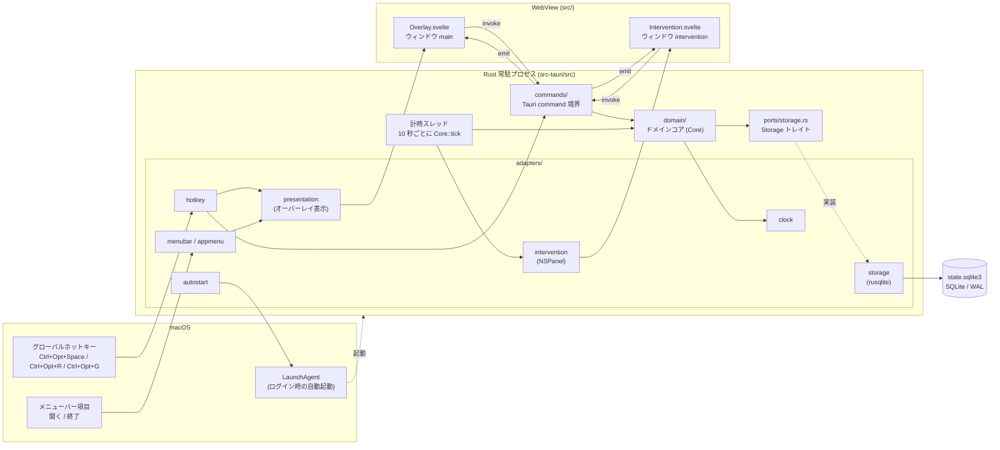
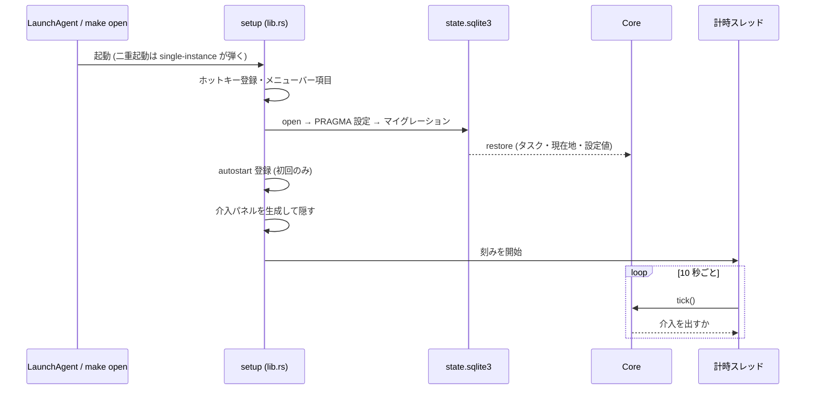

# 構成図

macOS 常駐の Tauri 2 アプリである。Rust 側 (`src-tauri/`) が状態と判断をすべて持ち、
Svelte 側 (`src/`) は表示と打鍵の受け付けだけを行う。

## 全体

## 層の分割 (ports and adapters)

| 層 | 場所 | 責務 | 守っていること |
| --- | --- | --- | --- |
| ドメインコア | `src-tauri/src/domain/` | タスク・ステップ・現在地・休息・介入の判断 | OS も SQLite も知らない。判断は純粋関数 |
| ポート | `src-tauri/src/ports/` | コアが永続化に要求する契約 (`restore` / `apply`) | `rusqlite` の型を出さない。1 メソッド = 1 トランザクション |
| アダプタ | `src-tauri/src/adapters/` | OS API・SQLite・ウィンドウ操作 | OS API を呼んでよい唯一の場所 |
| コマンド境界 | `src-tauri/src/commands/` | フロントエンドからの `invoke` を受ける | 型は `Overlay.svelte` / `Intervention.svelte` の TS 型と 1:1 |
| 提示層 | `src/` | 表示と打鍵 | 状態を持たない。表示のたびにスナップショットを取り直す |

ドメインの内訳:

| ファイル | 中身 |
| --- | --- |
| `domain/task.rs` | タスク・ステップ・中断メモ。ID は UUID v7、順序は `ordinal` |
| `domain/position.rs` | 現在地 (未着手 / 活性 / 非活性) と `activated_at` |
| `domain/switch.rs` | 切り替え履歴 (メモ本文は持たない) |
| `domain/rest.rs` | 休息閾値・猶予・休息の長さ、介入の判定、スリープ検出 |
| `domain/setting.rs` | 設定値 (鍵と文字列の組) と、その読み方 |
| `domain/state.rs` | `Core` — 上をまとめて状態を移し、ストレージへ確定させる |

## ウィンドウ

`src-tauri/tauri.conf.json` で 2 枚を定義し、どちらも起動時は非表示で生成しておく。

| ラベル | 大きさ | 中身 | 性質 |
| --- | --- | --- | --- |
| `main` | 640×280 | オーバーレイ (`src/overlay/Overlay.svelte`) | 呼び出して使ったら消える。Esc・フォーカス離脱で閉じる |
| `intervention` | 340×150 | 介入パネル (`src/intervention/Intervention.svelte`) | NSPanel。入力先を奪わない。応答はグローバルホットキー |

## コマンドとイベント

フロントエンド → Rust (`invoke`):

| コマンド | 呼び手 | 用途 |
| --- | --- | --- |
| `get_overlay_snapshot` | Overlay | 既定表示 (次の一手) の取得 |
| `switch_current_position` | Overlay | 切り替え (`Enter`) |
| `complete_current_step` | Overlay | 完了して次を選ぶ (`⌘Enter`) |
| `get_disclosure_surface` | Overlay | 一覧 (`⌘L`) |
| `select_step` | Overlay | 一覧から現在地を移す |
| `create_task` | Overlay | タスクを作る (`⌘N`) |
| `get_task_draft` / `edit_task` | Overlay | タスクを直す (`⌘E`) |
| `begin_rest` / `end_rest` | Overlay | 休息に入る (`⌘R`) / 終える |
| `hide_overlay` / `mark_overlay_hidden` | Overlay | 閉じる |
| `get_intervention_snapshot` | Intervention | 介入パネルの中身 |
| `answer_intervention` | Intervention | 介入への応答 |

Rust → フロントエンド (`emit`)。**ペイロードを持たない** — 受け手は必ずスナップショットを
取り直す。

| イベント | 意味 |
| --- | --- |
| `current_position_changed` | 現在地が変わった |
| `task_created` | タスクが作られた |
| `intervention_raised` | 介入が発せられた |

## 起動の流れ

`src-tauri/src/lib.rs` の `setup`:

DB が読めなくても常駐は止めない (コアが `manage` されないだけで、ホットキーと終了は働く)。

## ファイルの置き場所

| 置き場所 | 中身 |
| --- | --- |
| `~/Library/Application Support/dev.onzuka.mytaskmanager/state.sqlite3` | DB 本体 (隣に `-wal` / `-shm`) |
| `~/Library/Application Support/dev.onzuka.mytaskmanager/autostart-registered` | 自動起動を一度登録した印 |
| `~/Library/Logs/dev.onzuka.mytaskmanager/` | ログ (ローカルのみ) |
| `~/Library/LaunchAgents/my-task-manager.plist` | 自動起動の登録 |
