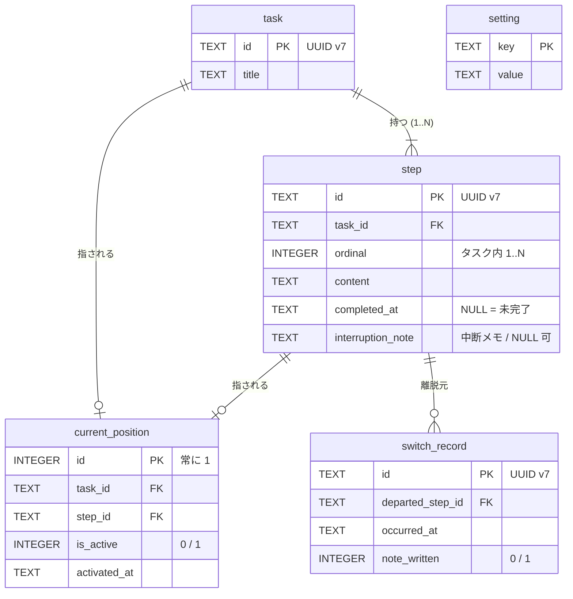

# DB 設計

SQLite 1 ファイルである。定義は `src-tauri/src/adapters/storage/schema.rs`、読み書きは
`src-tauri/src/adapters/storage/mod.rs` にある。

- 場所: `~/Library/Application Support/dev.onzuka.mytaskmanager/state.sqlite3`
- ドライバ: `rusqlite` (`bundled` — SQLite 本体を同梱し、OS 同梱版の差を排除する)
- 全表 `STRICT`

## ER 図



`setting` はどの表とも結ばれていない。

## 表

### `task` — タスク

| 列 | 型 | 制約 | 意味 |
| --- | --- | --- | --- |
| `id` | TEXT | PK, NOT NULL | UUID v7 |
| `title` | TEXT | NOT NULL | 題名 |

### `step` — ステップ

| 列 | 型 | 制約 | 意味 |
| --- | --- | --- | --- |
| `id` | TEXT | PK, NOT NULL | UUID v7。現在地はこの ID を指す (`ordinal` ではない) |
| `task_id` | TEXT | NOT NULL, FK → `task.id` | 所属タスク |
| `ordinal` | INTEGER | NOT NULL | タスク内の通し番号 1..N。追記のたびに振り直す |
| `content` | TEXT | NOT NULL | ステップの中身 |
| `completed_at` | TEXT | NULL 可 | 完了時刻。NULL なら未完了 |
| `interruption_note` | TEXT | NULL 可 | 中断メモ (ステップに対して 0..1 なので別表にしない) |

索引: `step_by_task (task_id, ordinal)`

タスクの全ステップに `completed_at` が入ると、そのタスクは一覧から消える (行は残る)。

### `current_position` — 現在地

| 列 | 型 | 制約 | 意味 |
| --- | --- | --- | --- |
| `id` | INTEGER | PK, `CHECK (id = 1)` | **1 行しか存在できない** |
| `task_id` | TEXT | NOT NULL, FK → `task.id` | 現在地のタスク |
| `step_id` | TEXT | NOT NULL, FK → `step.id` | 現在地のステップ |
| `is_active` | INTEGER | `CHECK IN (0, 1)` | 1 = 活性 (作業中) / 0 = 非活性 (休息中) |
| `activated_at` | TEXT | NOT NULL | 活性になった時刻。連続作業時間の起点 |

**行が無い = 未着手**である。

### `switch_record` — 切り替え履歴 (版 2 で追加)

| 列 | 型 | 制約 | 意味 |
| --- | --- | --- | --- |
| `id` | TEXT | PK, NOT NULL | UUID v7 |
| `departed_step_id` | TEXT | NOT NULL, FK → `step.id` | 離れたステップ |
| `occurred_at` | TEXT | NOT NULL | 切り替えた時刻 |
| `note_written` | INTEGER | `CHECK IN (0, 1)` | 中断メモを書いたか。**本文は持たない** |

追記専用で、製品コードには読み出す経路が無い (測定用。必要時に SQL で直接数える)。
索引は張っていない。

### `setting` — 設定値

| 列 | 型 | 制約 | 意味 |
| --- | --- | --- | --- |
| `key` | TEXT | PK, NOT NULL | 鍵 |
| `value` | TEXT | NOT NULL | 値 (文字列のまま保存し、解釈は読み手が行う) |

**空であることが正常な状態である。** 行が無ければコード内の既定値を使う。使っている鍵と
修正方法は [settings.md](settings.md) を参照。

## 値の表現

| 種類 | 表現 |
| --- | --- |
| ID | UUID v7 の文字列 (`uuid` クレート) |
| 時刻 | UTC の ISO 8601、ミリ秒付き。`YYYY-MM-DDTHH:MM:SS.fffZ` (オフセット表記は読めない) |
| 真偽 | INTEGER 0 / 1 |

## 接続時の PRAGMA

`schema::configure` が開くたびに設定する。

| PRAGMA | 値 | 理由 |
| --- | --- | --- |
| `foreign_keys` | ON | SQLite の既定は OFF で、宣言した外部キーが効かない |
| `journal_mode` | WAL | 書き込み中に落ちても確定済みのコミットを失わない。WAL に入れなければ失敗にする |
| `synchronous` | NORMAL | WAL と組の選択。OS ごと落ちた場合は直近のコミットを失いうる |

## 書き込みの単位

`ports/storage.rs` の `Storage::apply(&Commit)` が **1 回 = 1 トランザクション**である。
`Commit` は「書き直すタスク (ステップ込み)」「置き換える現在地」「追記する切り替え履歴」
「置き換える設定値」を同時に運ぶ。切り替え 1 回のメモ確定・現在地移動・履歴追記が
割れずに確定するのはこのためである。

**`DELETE` する経路はどこにも無い。** タスクもステップも削除しない。

## マイグレーション

外部クレートを使わず `PRAGMA user_version` で版を管理する。

| 版 | 内容 |
| --- | --- |
| 1 | `task` / `step` / `current_position` / `setting` |
| 2 | `switch_record` |

- `MIGRATIONS` は**追記専用**。適用済みの版の SQL を書き換えても、既存の DB には二度と
  適用されない。列や表を足すときは新しい版を末尾に足す。
- 1 版の適用と `user_version` の更新は同じトランザクションで行う。
- コードより新しい版・負の版の DB は、何も適用せずエラーにする (常駐は止めない)。

現在の版は次で確かめられる。

```sh
sqlite3 ~/Library/Application\ Support/dev.onzuka.mytaskmanager/state.sqlite3 'PRAGMA user_version;'
```
